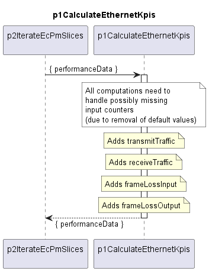

# p1CalculateEthernetKpis

Adds Ethernet KPIs to the historicalPerformanceData set.  

## Overview

This function processes a single PM data slice and adds:  

- transmitTraffic
- receiveTraffic
- frameLossInput
- frameLossOutput

If removal of ONF default values is activated, input attributes to compute these metrics may be missing.  
The function is taking this into consideration.  
In case that a metric cannot be computed, it is simply not added to the output object (performanceData).  

## Diagram

  

## Interface

Please find a detailed description of the [interface](interface.yaml).  

## Variables

Please find a detailed description of the [variables](variables.yaml).  

## NPM Module

[mw-sdn-p1-calculate-ethernet-kpis](https://www.npmjs.com/package/mw-sdn-p1-calculate-ethernet-kpis)  
